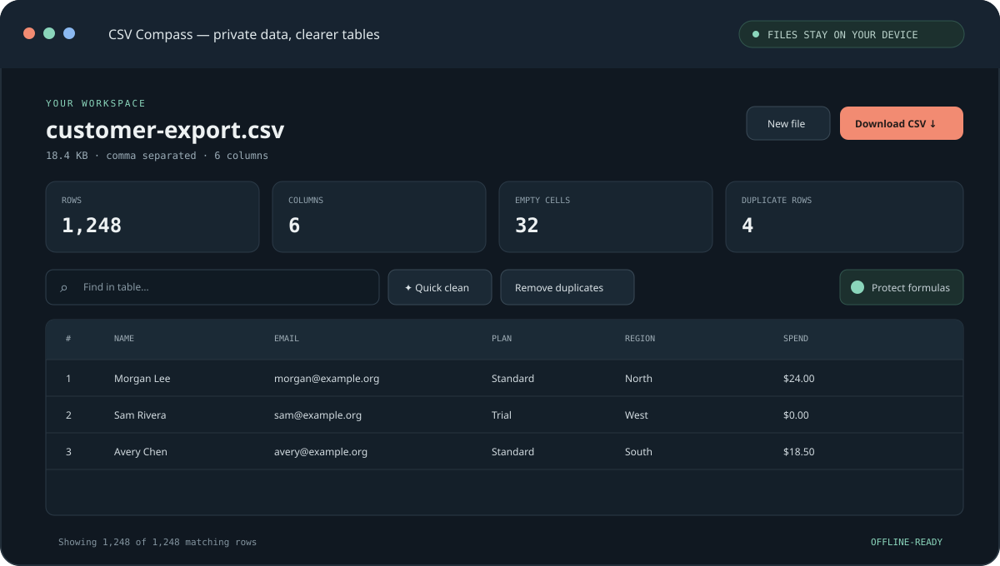

# CSV Compass

**A private, offline-ready CSV inspector and cleaner that runs entirely in your browser.** Open a file, understand its shape, make reversible cleanup changes, and export the result. The file is processed on your device and is never uploaded.

**[Open CSV Compass](https://ghostnever-lkm.github.io/csv-compass/)** · **[Report an issue](https://github.com/GhosTnever-lkm/csv-compass/issues)**



## Why CSV Compass

Spreadsheet cleanup often means handing sensitive data to an online converter. CSV Compass keeps the whole workflow in the browser: files are read with the local File API, parsed in the current tab, and exported directly to your device. There is no account, analytics SDK, backend, or external parser dependency. The app also works offline after its first visit when installed as a PWA.

## Features

- Inspect row and column counts, blank cells, and duplicate rows.
- Open comma, semicolon, tab, and pipe separated text files, including quoted delimiters and multiline fields.
- Reject malformed quotes with a clear error instead of silently accepting a potentially altered table; delimiter detection samples complete records, including quoted multiline fields.
- Search all cells in the visible table preview.
- Trim leading and trailing whitespace and collapse repeated spaces.
- Remove duplicate records with one-step undo.
- Export the cleaned table as UTF-8 CSV with formula-injection protection enabled by default.
- Light and dark themes; responsive layout; keyboard-accessible file picker.
- Local-only processing; supported files up to 100 MB.

## Use it

1. Open the [web app](https://ghostnever-lkm.github.io/csv-compass/) or download this repository.
2. Choose a `.csv` or `.tsv` file, or drop it onto the start panel.
3. Review the file profile, search, and apply cleanup actions as needed. Use **Undo** to reverse the last cleanup.
4. Download the cleaned CSV.

To run a local copy, serve this folder with any static file server. For example:

```sh
python -m http.server 8000
```

Then open `http://localhost:8000`. A web server is required for service-worker offline caching; the table tool itself works without an account or backend.

## Privacy and safety

- No file contents are sent to a server. No network requests are made by the app after static assets are loaded.
- The export option **Protect formulas** prefixes values beginning with spreadsheet formula characters, reducing CSV formula-injection risk when opening untrusted data in spreadsheet software. Review the output before sharing it.
- The app does not execute cell contents as HTML or formulas.
- CSV Compass is a convenience tool, not a replacement for a controlled data-processing environment for regulated or high-risk datasets.

## Current limits

- The first row is treated as the header row.
- The table preview shows up to 500 matching rows at once; cleanup and export apply to the whole file.
- Files are held in memory while open. Very large files can use substantial browser memory.
- Spreadsheet formatting, formulas, and multiple sheets are outside the CSV format and are not retained.

## Development

The app is plain HTML, CSS, and JavaScript with no build step or runtime dependencies. To run the core parser and export checks:

```sh
node --test csv-core.test.mjs
```

The `main` branch deploys automatically to GitHub Pages through the workflow in `.github/workflows/pages.yml`.

## Release history

See [CHANGELOG.md](CHANGELOG.md). The current version is **0.1.1**.

## ☕ Support / Pro Version

CSV Compass is free and open source. There is no paid Pro version at this time. Optional support: [Buy Me a Coffee](https://buymeacoffee.com/azizazimov8) · [Boosty](https://boosty.to/azizazimov) · [GitHub Sponsors](https://github.com/sponsors/GhosTnever-lkm).

Public donation addresses (send only the matching asset on the matching network):

| Network | Address |
| --- | --- |
| TRON (TRC-20) | `TCBSy38X57hA6w2onJcxom24x1febc1mP1` |
| BNB Smart Chain (BEP-20) | `0xD431a917961E0b086B96D9F72b5C8fF19b19068a` |
| Bitcoin | `bc1qn75pj4n7gyl2k5kf2f97elyvenz52q6nn2g30u` |

## License

MIT. See [LICENSE](LICENSE).
